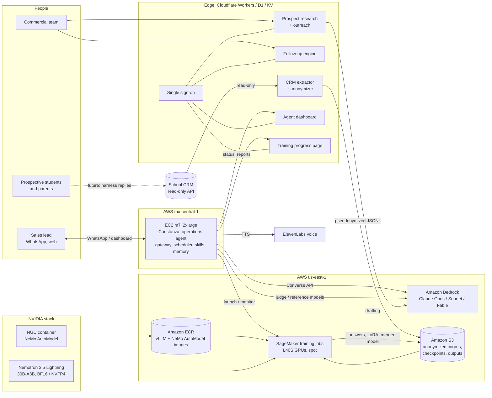
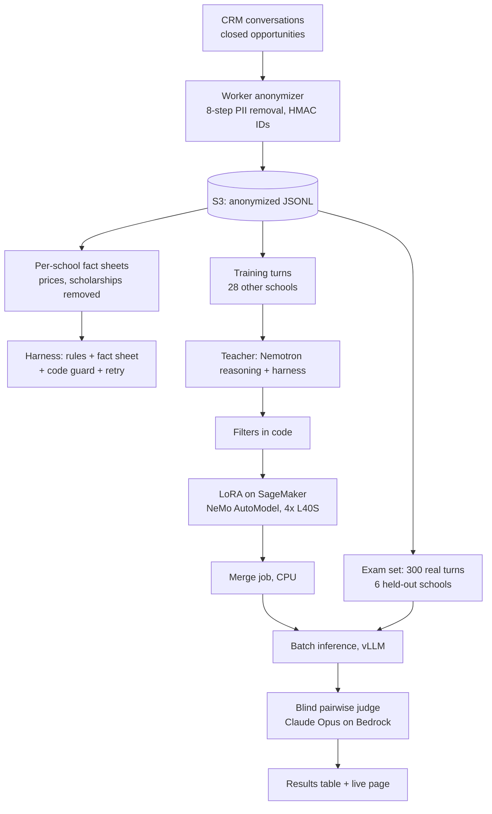

# Architecture

[Español](../es/architecture.md) · [Back to README](../../README.md)

SuperLeads runs three layers that share data and infrastructure:

1. **Constanza, our always-on AI** (operations agent built on the open-source Hermes Agent framework) on Amazon EC2, driven by Claude Opus on Amazon Bedrock.
2. **An admissions-AI research stack**: anonymized CRM data in Amazon S3, GPU jobs on Amazon SageMaker with NVIDIA
   Nemotron, and a blind evaluation judged on Bedrock.
3. **Products** used by the commercial team and by schools, mostly on Cloudflare Workers, calling AI models.

## System diagram

## 1. Constanza: operations agent on EC2

Constanza coordinates a team of specialized AI "employees" (one per social network, one for SEO and websites, one
for clients and partners), each visible on the supervisor dashboard. The same harness used in the admissions exam is
planned as Constanza's admissions layer for conversations with prospective students.

| Piece | What it does |
|---|---|
| Host | One EC2 m7i.2xlarge (8 vCPU, 30 GiB RAM) in **mx-central-1**, running 24/7 |
| Model | Claude Opus 5.5 on Bedrock (us-east-1 cross-region profile); Claude Fable 5.2 for some jobs |
| Channels | WhatsApp (text and voice notes), a web dashboard, email digests |
| Voice | ElevenLabs text-to-speech for voice replies |
| Scheduler | 71 scheduled routines defined, 54 enabled; 14 of them are script-only (no model call) |
| Memory and skills | Persistent memory plus procedural "skills" that the agent updates after each job |

**What the routines do (grouped, no client names):**

| Group | Examples of routines |
|---|---|
| Content and social media | Daily posts per network, short videos, data videos, content bank, articles, community participation |
| SEO and AI visibility | Daily technical audit, page-2-to-page-1 pass, SEO autopilot for two sites, weekly AI-answer visibility loop |
| Sales intelligence | Daily signals from public data (new admissions directors, new programs, job posts), prospect research, partnerships |
| Outreach operations | Paced message sending and reply handling for an outreach campaign, with daily learning summaries |
| Supervision | Live dashboard (every 2 min), routine reports (every 30 min), daily routine review, daily work log, repo backups |
| ML operations | Training watcher (every 15 min), Bedrock model-availability probe (every 3 h), live training page (every minute), idea box answered by the agent |

## 2. Admissions-AI research stack

Details: [Training and evaluation](training-and-evaluation.md).

## 3. Products (architecture only)

| Product | Purpose | Stack | AI |
|---|---|---|---|
| Follow-up engine | Each morning, each salesperson sees whom to write, what to say and why; CRM fills itself | Cloudflare Workers + D1 (history), CRM API (state) | Claude for drafting and screenshot reading |
| Prospect research + outreach | Sizes every institution in the CRM, researches decision makers, plans multichannel touches | Workers + D1 | Claude via Bedrock for research and message drafts (~US$0.007 per message) |
| Pre-meeting brief | For each booked diagnostic meeting, researches the school and emails a brief on meeting day | Worker + cron every 15 min | Claude |
| AI video generator | Brand videos in 2–3 minutes from an idea; horizontal and vertical | Remotion / HyperFrames, D1 | LLM script, ElevenLabs voice, generative video |
| Single sign-on | Google login restricted by domain, reused by every internal tool | Cloudflare Pages Functions + D1 | — |
| Agent dashboard | Live state of the agent and its routines; send instructions by text or voice | Worker + KV, behind SSO | Constanza answers |
| Training page | Plain-language progress of the admissions AI, examples, idea box | Worker + KV, behind SSO | Constanza answers ideas |

## Data boundaries

- The CRM app is **read-only**. Nothing is written to schools' CRMs by the research stack.
- Raw conversations never leave the Worker un-anonymized; a second server-side check quarantines any record with
  residual emails, phones, URLs or national IDs.
- Calendar event titles and notes are never read (they often contain names).
- Models from Anthropic run with Bedrock's data controls; Fable-class models require the `aws_review` retention mode,
  which we disclose whenever client data passes through them.
