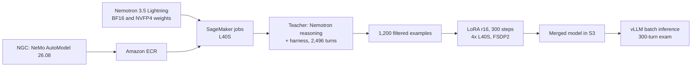

# NVIDIA

[Español](../es/nvidia.md) · [Back to README](../../README.md)

SuperLeads applied to **NVIDIA Inception** on 1 Oct 2026 and was accepted on 8 Oct 2026. Our goal is to say, truthfully,
"we trained our own admissions AI on NVIDIA", and to serve it on AWS.

## What we use from NVIDIA today

| NVIDIA technology | How we use it |
|---|---|
| **Nemotron 3.5 Lightning 30B-A3B** (BF16) | Base model for every fine-tuning run (LoRA v3, v4, v5). A hybrid mixture-of-experts model with ~3B active parameters per token: large-model quality at small-model serving cost |
| **Nemotron 3.5 Lightning 30B-A3B NVFP4** | Quantized checkpoint for batch inference of the untrained model on a single L40S (ml.g6e.2xlarge, ~US$2.80/h list) |
| **NeMo AutoModel 26.08** (NGC container) | Training framework for LoRA: FSDP2, activation checkpointing, Transformer Engine attention, agent-chat dataset loader with reasoning-content handling. Mirrored from NGC into Amazon ECR for SageMaker |
| **Transformer Engine, Mamba kernels** | Verified inside the container before the first paid job |
| **NVIDIA L40S** (ml.g6e.2xlarge / 12xlarge) | All billed training and inference: 24.1 GPU-instance hours |
| **NVIDIA H100** (ml.p5.4xlarge) | Requested as the second lane of every capacity race; never received capacity in 4 attempts |
| **Nemotron reasoning mode** | Teacher in the v5 distillation: reasoning cut invented facts from ~20% to ~7% |

## NVIDIA-only training chain

Teacher, student and the fact sheets used as training context are **all Nemotron**. This keeps the trained weights
free of third-party model outputs (Anthropic's terms do not allow using Claude or Fable outputs to train another model
without written permission), and it makes the result an NVIDIA story end to end.

## Results on Nemotron, in one line each

- Untrained Nemotron + our harness already beats the admissions AI schools use today: **5.8–6.5 vs 4.2–4.8**.
- With reasoning: **7.3** (judge 1). Fine-tuned v5 answering instantly: **7.2**, at **~1/20 of the tokens**.
- Fine-tuned v5 with reasoning: **7.4** (judge 1) / **6.7** (judge 2), **0% price quotes**, offers the visit in 90–92%.
- Gap to the best closed model (Fable 5.2: 8.2 on judge 2) is now ~1.5 points; the levers to close it are better fact
  sheets, a stronger teacher, and a bigger NVIDIA model (see roadmap).

## How we use Inception, and the plan

**Used so far:** membership and positioning ("trained by SuperLeads on NVIDIA"); NVIDIA's open models and NGC
containers; the **US$10k AWS Activate Portfolio credits** offered through the Inception benefits catalog (requested and
approved Oct 2026; they fund the AWS work in this repository); 20 NVIDIA DLI training codes. **Requested:** the
US$1,000 Brev credits pilot for Inception members (Nov 2026). We have **not yet drawn** DGX Cloud credits or NIM, and
we have not yet used NVIDIA technical support. This is honest accounting, not a complaint: we had to show results first.

**What we would ask NVIDIA for next:**

1. **Technical guidance** on Nemotron for Mexican Spanish customer conversations: LoRA vs full fine-tune for MoE,
   reasoning budget control, and whether NVFP4 serving of a merged LoRA model keeps quality.
2. **GPU access** (DGX Cloud or credits via AWS) for: a larger Nemotron as teacher and student, a 3-month always-on
   pilot endpoint, and ASR on 621 hours of phone calls.
3. **NIM** to serve the fine-tuned model behind an OpenAI-compatible endpoint on AWS, replacing our batch-only vLLM jobs.
4. **Speech**: NVIDIA ASR (Parakeet / Canary family) on Spanish telephony audio, then a voice agent that books visits.
5. **Guardrails**: compare our code guard with NeMo Guardrails for price/scholarship policies.
6. **Co-marketing**: a case study on an LATAM education AI built on Nemotron and AWS, once the pilot has results.

Experiment-by-experiment costs are in [Roadmap and credits ask](roadmap-and-credits-ask.md).
