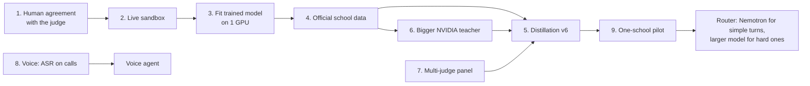

# Roadmap and credits ask

[Español](../es/roadmap-and-credits-ask.md) · [Back to README](../../README.md)

The first research phase spent its internal GPU cap ($299.51 of $300) and produced a fine-tuned Nemotron that beats
the admissions AI schools use today in an offline exam. What remains is to prove it with people and in production.

**All costs below are estimates** based on our measured job costs and public list prices
(ml.g6e.2xlarge ~US$2.80/h, ml.g6e.12xlarge ~US$13.12/h, ml.p5.4xlarge ~US$7.91/h). Spot and credits change actuals.

## Plan, in order

## Experiments and estimated cost

| # | Experiment | Question it answers | Resources | Est. cost (USD) |
|---|---|---|---|---|
| 1 | Human blind test: 30 reply pairs, 2 admissions experts | Does the AI judge agree with humans (target ≥80%)? | Our web page | 0 |
| 2 | Live sandbox: 10 one-hour sessions writing as prospects | How does it behave off-exam (prices, insults, odd questions)? | g6e.12xlarge, 10 h | ~130 |
| 3 | Quantize merged v5 to NVFP4 and re-run the exam on 1× L40S | Can the trained model serve at $2.80/h instead of $13.12/h? | g6e.12xlarge 1 h + g6e.2xlarge 1 h + 1 judge pass | ~30 |
| 4 | Fact sheets from official school data; re-exam 3 systems | How much of the remaining 5–10% invention is the sheet's fault? | Bedrock + 1 GPU exam | ~60 |
| 5 | Distillation v6: better sheets, bigger thinking budget, 3 ablations (rank, epochs, data mix) | How close can Nemotron get to 8.0? | 3 × (teacher + LoRA + merge + exam), v5 cost $70 each | ~250 |
| 6 | Larger Nemotron as teacher (and student), multi-GPU H100 | Does a bigger NVIDIA teacher close the gap to closed models? | 8× H100 for ~6 h | ~300–600 |
| 7 | Multi-judge panel including non-Anthropic models | Remove judge-family bias from our numbers | Bedrock, 3 judges × 3 systems | ~100 |
| 8 | Voice: transcribe 50 calls, then the full 621 h | Does ASR understand Mexican Spanish on phone audio? | NVIDIA ASR on L40S (~20 GPU-h) or Amazon Transcribe (~$894 at list for 621 h) | ~60 (GPU) to ~900 |
| 9 | One-school pilot, 3 months, real prospects | **Does it book more visits than today?** | Always-on 1× L40S endpoint (2,190 h) + Bedrock for hard turns | ~7,000 |
| 10 | Keep the operations agent running 6 months | Content, SEO, sales signals, supervision | Bedrock Opus (Nov run-rate ~$1,250/month at list) + EC2 (~$300/month) | ~9,300 |

**Research track (1–8): ~US$0.9k–2.1k. Pilot (9): ~US$7k. Operations (10): ~US$9.3k for 6 months.**

Our current AWS credits (about US$9k left of the US$10k AWS Activate Portfolio credits obtained through NVIDIA Inception in Oct 2026; balance per the team, not verified from the server) cover the operations
agent and the first experiments. **The pilot and always-on serving are what more credits unlock.**

## What more credits enable, concretely

- **AWS (Activate / credits):** the 3-month pilot on SageMaker (endpoint, autoscaling to zero out of hours), Bedrock
  for the router's hard turns and the multi-judge panel, Transcribe or GPU ASR for voice, and 6 more months of the
  operations agent. If the pilot works, the same stack rolls out to more schools in Mexico and LATAM.
- **NVIDIA (Inception):** H100 capacity or DGX Cloud for the larger-teacher experiment; NIM for serving; technical
  guidance on Nemotron MoE fine-tuning, NVFP4 serving and Spanish ASR; a joint case study once the pilot reports.

## Next credit tier we are asking for

AWS lists **AWS Credits for AI Startups** (US$200k+, invite only, for startups ready to scale after Activate Portfolio) as
the tier that goes through the startup's AWS Account Manager. That is the conversation this repository supports: the
pilot (9) and six months of operations (10) are the concrete uses.

## Decisions and dependencies (not money)

- Legal review for training on anonymized client conversations; contract clause with schools.
- Written permission from Anthropic before any Claude/Fable output can be a training target (until then, NVIDIA-only).
- Write scopes in the school CRM (send messages, create appointments) for live operation.
- A pilot school that already records its appointments in the CRM.

## Success criteria we commit to report

| Stage | Metric | Target |
|---|---|---|
| Human test | Agreement with the AI judge | ≥ 80% of pairs |
| Exam | Offers visit / price quotes / preferred over today's AI | ≥ 90% / 0% / ≥ 80% |
| Pilot | Share of leads that book a visit, vs the same school's prior period and vs today's AI | Report the lift with confidence interval, whatever it is |
| Cost | Serving cost per conversation | Report actuals |
