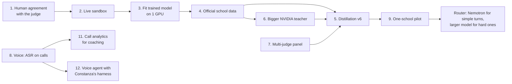

# Roadmap and credits ask

[Español](../es/roadmap-and-credits-ask.md) · [Back to README](../../README.md)

SuperLeads serves about 100 schools and universities and has grown 100% bootstrapped. We want the next stage of that
growth to run on AWS: **Constanza** (our AI) on Bedrock, **our own admissions model** on SageMaker, and **calls**
on Transcribe or NVIDIA GPUs, all anchored in **mx-central-1**.

The first research phase spent its internal GPU cap ($299.51 of $300) and produced a fine-tuned Nemotron that beats
the admissions AI schools use today in an offline exam. What remains is to prove it with people and in production,
and to open the calls line.

**All costs below are estimates** based on our measured job costs and public list prices
(ml.g6e.2xlarge ~US$2.80/h, ml.g6e.12xlarge ~US$13.12/h, ml.p5.4xlarge ~US$7.91/h). Spot and credits change actuals.

## How our AWS workloads grow with us

| Track | AWS services | Today (measured) | Next stage (plan) | What drives growth |
|---|---|---|---|---|
| **Constanza, operations** | Bedrock (Claude), EC2 mx-central-1 | 50 active routines, a team of specialized AI "employees", ~14,400 model calls since Oct 2026 | 6 more months (~US$9.3k, est.) | More channels, routines and team members |
| **Constanza, admissions conversations** | Bedrock (harness, hard turns), SageMaker endpoint (Nemotron) | Offline exam: 8.2 (Claude Fable 5.2 + harness), 6.7 (our Nemotron v5 + harness) | One-school pilot (~US$7k, est.) | Each institution's prospect volume |
| **Our own model** | SageMaker GPUs, S3, ECR | 29 jobs, 24.8 h, $299.51; ~193 GB in S3 | Research track (~US$0.9k–2.1k, est.); larger Nemotron on H100 | Model quality and serving cost per conversation |
| **Calls** | Amazon Transcribe or NVIDIA ASR on GPU; Bedrock for analytics | 208,751 call records, 621 h > 30 s, none transcribed | Transcribe the backlog, call analytics, voice-agent pilot (~US$0.1k–1.05k, est., plus pilot actuals) | Hours of calls per institution |

From ~100 institutions to several times that, these workloads scale with conversations and call hours; the design
goal is that the team does not have to scale in the same proportion. We will report the actual cost per institution
once the pilot runs, instead of projecting it now.

## Plan, in order

## Experiments and estimated cost

| # | Experiment | Question it answers | Resources | Est. cost (USD) |
|---|---|---|---|---|
| 1 | Human blind test: 30 reply pairs, 2 admissions experts | Does the AI judge agree with humans (target ≥80%)? | Our web page | 0 |
| 2 | Live sandbox: 10 one-hour sessions writing as prospects | How does it behave off-exam (prices, insults, odd questions)? | g6e.12xlarge, 10 h | ~130 |
| 3 | Quantize merged v5 to NVFP4 and re-run the exam on 1× L40S | Can the trained model serve at $2.80/h instead of $13.12/h? | g6e.12xlarge 1 h + g6e.2xlarge 1 h + 1 judge pass | ~30 |
| 4 | Fact sheets from official school data; re-exam 3 systems | How much of the remaining 5–10% invention is the sheet's fault? | Bedrock + 1 GPU exam | ~60 |
| 5 | Distillation v6: better sheets, bigger thinking budget, 3 ablations (rank, epochs, data mix) | How close can Nemotron get to 8.0? | 3 × (teacher + LoRA + merge + exam), v5 cost $70 each | ~250 |
| 6 | Larger Nemotron as teacher (and student), multi-GPU H100 | Does a bigger NVIDIA teacher close the gap to closed models? | 8× H100 for ~6 h | ~300–600 |
| 7 | Multi-judge panel including non-Anthropic models | Remove judge-family bias from our numbers | Bedrock, 3 judges × 3 systems | ~100 |
| 8 | Voice: transcribe 50 calls, then the full 621 h | Does ASR understand Mexican Spanish on phone audio? | NVIDIA ASR (Parakeet / Canary) on L40S (~20 GPU-h) or Amazon Transcribe (~$894 at list for 621 h) | ~60 (GPU) to ~900 |
| 9 | One-school pilot, 3 months, real prospects | **Does it book more visits than today?** | Always-on 1× L40S endpoint (2,190 h) + Bedrock for hard turns | ~7,000 |
| 10 | Keep Constanza (operations) running 6 months | Content, SEO, sales signals, supervision | Bedrock Opus (Nov run-rate ~$1,250/month at list) + EC2 (~$300/month) | ~9,300 |
| 11 | Call analytics for admissions coaching on the 621 h of transcripts | Which advisor behaviours on the phone go with booked visits? | Bedrock over ~8M transcript tokens (assumes ~150 spoken words/min) | ~50–150 |
| 12 | Voice-agent pilot: Constanza's harness behind our Dapta voice agents, one institution, 1 month | Does a call minutes after sign-up book more visits than today? | Bedrock for the harness; telephony through Dapta (outside AWS) | Report actuals |

**Research track (1–8): ~US$0.9k–2.1k. Call analytics (11): ~US$50–150. Pilot (9): ~US$7k. Operations (10):
~US$9.3k for 6 months. Voice pilot (12): measured, not projected.**

Our current AWS credits (about US$9k left of the US$10k AWS Activate Portfolio credits obtained through NVIDIA
Inception in Oct 2026; balance per the team, not verified from the server) cover Constanza's operations and the first
experiments. **The pilot, always-on serving and the calls line are what more credits unlock.**

## What more credits enable, concretely

- **AWS (Activate / credits):** the 3-month pilot on SageMaker (endpoint, autoscaling to zero out of hours), Bedrock
  for Constanza's hard turns and the multi-judge panel, Transcribe or GPU ASR for calls, call analytics, and 6 more
  months of Constanza's operations. If the pilot works, the same stack rolls out institution by institution in Mexico
  and LATAM, from mx-central-1.
- **NVIDIA (Inception):** H100 capacity or DGX Cloud for the larger-teacher experiment; NIM for serving; technical
  guidance on Nemotron MoE fine-tuning, NVFP4 serving and Spanish telephony ASR; a joint case study once the pilot
  reports.

## Next credit tier we are asking for

AWS lists **AWS Credits for AI Startups** (US$200k+, invite only, for startups ready to scale after Activate Portfolio) as
the tier that goes through the startup's AWS Account Manager. That is the conversation this repository supports: the
pilot (9), six months of operations (10) and the calls line (8, 11, 12) are the concrete uses, and they are the
workloads that grow with every institution we add.

## Decisions and dependencies (not money)

- Legal review for training on anonymized client conversations; contract clause with schools.
- Written permission from Anthropic before any Claude/Fable output can be a training target (until then, NVIDIA-only).
- Write scopes in the school CRM (send messages, create appointments) for live operation.
- A pilot school that already records its appointments in the CRM.
- Consent and notice rules for transcribing and analysing recorded calls; recordings are anonymized like chats.

## Success criteria we commit to report

| Stage | Metric | Target |
|---|---|---|
| Human test | Agreement with the AI judge | ≥ 80% of pairs |
| Exam | Offers visit / price quotes / preferred over today's AI | ≥ 90% / 0% / ≥ 80% |
| Pilot | Share of leads that book a visit, vs the same school's prior period and vs today's AI | Report the lift with confidence interval, whatever it is |
| Calls | ASR word error rate on Mexican Spanish phone audio; visits booked by the voice agent | Report actuals |
| Cost | Serving cost per conversation and per institution | Report actuals |
