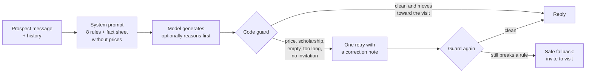
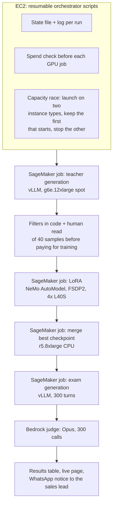

# Training and evaluation: an admissions AI on NVIDIA Nemotron

[Español](../es/training-and-evaluation.md) · [Back to README](../../README.md)

**Goal.** An AI that answers prospective students and parents of private schools and universities with one objective:
**get them to book a campus visit**. It must never quote prices or scholarships (schools want those discussed in
person), never invent facts, and sound warm and brief, in Mexican Spanish, at any hour.

**Status (13 Nov 2026).** Five iterations in five days. The third fine-tuning run worked. The model is stored, not
serving; it has not talked to a real prospect yet.

## 1. Data

| Dataset | Size | Source | Use |
|---|---|---|---|
| Closed conversations | **1.3M chat messages, 86k prospects, 80 schools**, Oct 2023 – Nov 2026 | School CRM, read-only API | Analysis, fact sheets, training turns |
| Appointment ground truth | 354,602 leads, 101 schools, 12 months | CRM calendars (pseudonymized fields only) | Success metric: share of leads that book |
| Phone calls (metadata only) | 208,751 calls; 621 hours longer than 30 s | CRM | Not transcribed yet (voice is on the roadmap) |
| Exam set | **300 real turns, 50 per school, 6 held-out schools** | Conversations where today's AI answered | Blind evaluation of every system |
| Teacher pool (v5) | 2,496 turns, one per opportunity, 28 schools | Training schools only | Distillation |

**Anonymization (before data leaves the extraction Worker):** known names of contacts, advisors and companies;
regex patterns (email, phone, URL, national IDs, tax IDs, postal codes, addresses, numbers of 6+ digits); context
patterns ("my name is", "my son…", titles); a dictionary of 38k Mexican first and last names; any capitalized word
outside a 50k-word Spanish vocabulary. All IDs become salted HMAC-SHA256 pseudonyms. A second server-side scan
quarantines any record with residues. Attachments and recordings are dropped.

**Fact sheets ("fichas").** For each school, a model reads what the institution itself sent (deduplicated, ranked by
frequency and recency) and writes a ~5k-character sheet: programs, schedules, requirements, admission steps, location,
FAQs and what is *not* offered. Before reaching the assistant, the cost, scholarship and payment sections and any line
with an amount are removed in code. Sheets used for training are written by Nemotron itself on our GPU, so no
Anthropic output enters training data, even as context. Exam conversations are excluded from the sheets' sources.

## 2. The harness

Rules: advance toward the visit in every reply; never prices; never scholarships or discounts; only facts from the
sheet; no invented time slots; warm, 1–3 sentences, ≤350 characters; disclose being an AI only if asked; stop when
the prospect is not interested. The guard is code, not a model, and was validated against judged data before use
(its "no invitation" detector is right 96% of the time it flags).

## 3. The exam

- **300 real turns** from 6 schools that never enter training. Every system receives the same message and history.
- **Blind pairwise judge**: Claude Opus 4.7 (judge 1) and Claude Opus 5.5 (judge 2) on Bedrock see the school's
  full fact sheet, the conversation and two replies in random order (candidate vs today's AI). Per reply:
  offers visit, quotes price, mentions scholarships, invents, progress toward visit, tone, global (capped at 4 when a
  rule is broken), and which one it would send.
- Guard interventions are reported next to scores.
- Same order A/B for both judges; reasoning leaks and empty answers are counted before judging.

## 4. The pipeline on AWS

SageMaker *training jobs* are used for batch inference as well as training: they bill per second, stop on their own,
and fit a budget-capped research project better than an always-on endpoint.

## 5. Five iterations

| # | What | Data | Setup | Result |
|---|---|---|---|---|
| v3 | Fine-tune on full human-advisor conversations | 5,422 conversation segments | LoRA r16/α32, seq 4096, LR 1e-4, all turns | **Worse than untrained** (4.3 vs 4.9, earlier exam). $116 GPU |
| Harness v0 | Rules + sheet + code guard, no training | — | Nemotron base | 6.5 vs 4.8 for today's AI (judge 1). $0.41 GPU |
| v4 | Fine-tune on human replies that advanced a visit | ~850 examples, 41 schools, filtered from 96,895 replies | LoRA, GBS 8, 3 epochs, 263 steps | **Worse than untrained** (6.2 vs 6.5). Validation loss fell 1.94 → 1.53 anyway. $42 GPU |
| Harness v1 | Reason first, retry once if the guard flags | — | Nemotron base, reasoning on | **7.3** (judge 1). Reasoning cut invention from 20% to 7%. $2.30 GPU |
| **v5** | **Distillation: student learns the teacher's answers** | **1,200 teacher examples**, 28 schools | LoRA r16/α32, seq 4096, LR 1e-4, GBS 8, 2 epochs, 300 steps, last turn only | **7.2 answering instantly** (vs 6.5 untrained), 7.4 with reasoning. Validation loss 0.88 → 0.69. **$70.33 GPU end-to-end, ~6.5 h** |

v5 teacher = untrained Nemotron reasoning inside harness v1; student = Nemotron answering without reasoning. Both
NVIDIA. The trained student nearly matches the teacher (7.2 vs 7.3) using **15.9k vs 333k generated tokens for 300
replies (~1/20)**, which is what makes real-time serving affordable.

## 6. Results

**Judge 1 (Claude Opus 4.7), 300 turns**

| System | Global | Offers visit | Price | Scholarships | Invents | Preferred over today's AI |
|---|---|---|---|---|---|---|
| Today's AI (CRM built-in, GPT-4.1, each school's prompt) | 4.8 | 29% | 7% | 8% | 30% | — |
| Nemotron base + harness v0 | 6.5 | 69% | 0% | 0% | 20% | 73% |
| Nemotron v4 (human replies) + harness | 6.2 | 66% | 0% | 1% | 15% | 66% |
| Nemotron base + harness v1, reasoning | 7.3 | 85% | 0% | 0% | 7% | 83% |
| **Nemotron v5 (distilled) + harness v1, instant** | **7.2** | **89%** | **0%** | **0%** | **10%** | **80%** |
| **Nemotron v5 + harness v1, reasoning** | **7.4** | **90%** | **0%** | **0%** | **7%** | **81%** |
| Claude Sonnet 5.5 + harness | 8.0 | 92% | 0% | 0% | 5% | 92% |

**Judge 2 (Claude Opus 5.5, stricter), same 300 turns, plus Fable 5.2**

| System | Global | Offers visit | Price | Invents | Preferred over today's AI |
|---|---|---|---|---|---|
| Today's AI (GPT-4.1) | 4.2 | 32% | 8% | 34% | — |
| Nemotron base + harness v0 | 5.8 | 70% | 0% | 22% | 69% |
| Nemotron v4 + harness | 5.4 | 68% | 0% | 17% | 60% |
| Nemotron base + harness v1, reasoning | 6.5 | 86% | 0% | 10% | 78% |
| Nemotron v5 + harness v1, instant | 6.6 | 90% | 0% | 8% | 79% |
| **Nemotron v5 + harness v1, reasoning** | **6.7** | **92%** | **0%** | **5%** | **77%** |
| Claude Sonnet 5.5 + harness | 7.8 | 94% | 0% | 2% | 93% |
| **Claude Fable 5.2 + sheet + style examples + harness** | **8.2** | 94% | 0% | 2% | **96%** |

Thirteen candidate systems were judged against today's AI; the full tables live in the private research repo. Both judges rank the
systems in nearly the same order.

**Caveats that travel with every number**

- Both judges are Anthropic models and may favour Claude and Fable.
- The exam scores *our* rules; today's AI was never given them.
- "Invents" is judged against our fact sheet, which comes from conversations, not from official school data.
- No human has rated yet; nothing has been tested with live prospects.
- 23 replies from two reasoning variants were blocked by Bedrock's content filter for judge 2 and are reported apart.

## 7. Lessons

1. **A falling loss says nothing about the task.** v4's validation loss dropped 21% and the model got worse.
   Always run the exam.
2. **Human replies were never written under the rules being scored.** A model that copies them cannot beat a
   prompted model on those rules. Train on a teacher that follows the rules, with every behaviour (invite, confirm,
   say goodbye, defer unknown data) in its natural share, not 100% "invite".
3. **Reasoning is the lever, not the retry.** The second attempt fixed only 12 of 48 flagged replies.
4. **Distillation turns slow reasoning into fast answers** at ~1/20 of the tokens with almost no quality loss.
5. **Read samples before paying for GPUs.** Twice a training set looked right by count and was wrong by content.
6. **Check generation modes for leaks.** With reasoning enabled, unfinished thinking came out as the reply in 38 of
   300 cases until a rule in code caught it.
7. **The harness is only as right as its fact sheet.** Official school data is the next quality lever.
8. **Plan for GPU capacity.** On-demand L40S waited 30+ minutes and H100 (p5) never started in 4 attempts; launching
   on two instance types at once and keeping the first one avoided paying twice.
9. **Guard rules belong in code.** Zero price or scholarship quotes across every version, regardless of model.

## 8. Cost of the whole research track

| Item | Amount | Source |
|---|---|---|
| SageMaker GPU/CPU jobs | 29 jobs, 24.8 billable h, **$299.51** | Billable seconds × list price, per job |
| of which LoRA training | $259.17 (19.8 h), incl. $116 for the failed v3 approach | same |
| of which batch inference (exams, teacher, fact sheets) | $38.71 | same |
| of which merges (CPU) | $1.64 | same |
| Bedrock (judges and reference models) | 11,932 calls; 52.9M input, 3.8M output tokens | Per-call token log |
| Bedrock, judge-2 pass (13 systems × 300) | ~US$100 (estimate at list price) | Token log × list price |

The internal GPU cap for this phase ($300) is spent; all 29 jobs are in a final state (completed, stopped or failed).
