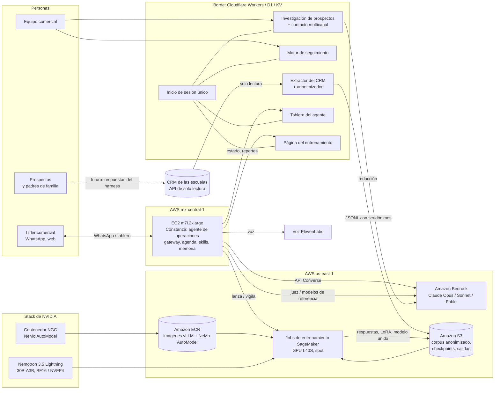
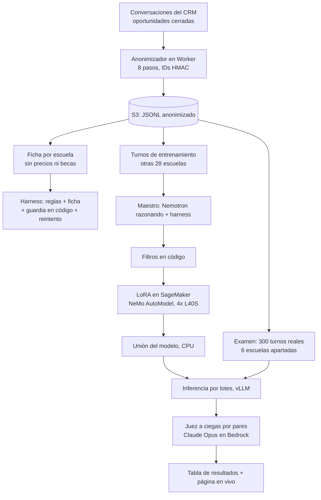

# Arquitectura

[English](../en/architecture.md) · [Volver al README](../../README.es.md)

SuperLeads opera en tres capas que comparten datos e infraestructura:

1. **Constanza, nuestra IA siempre encendida** (agente de operaciones construido sobre el framework abierto Hermes Agent) en Amazon EC2, con Claude Opus en Amazon Bedrock.
2. **Un laboratorio de IA de admisiones**: datos anonimizados del CRM en Amazon S3, jobs de GPU en Amazon SageMaker con
   NVIDIA Nemotron y un examen a ciegas calificado en Bedrock.
3. **Productos** que usan el equipo comercial y las escuelas, casi todos en Cloudflare Workers, que llaman a modelos de IA.

## Diagrama del sistema

## 1. Constanza: agente de operaciones en EC2

Constanza coordina un equipo de "empleados" de IA especializados (uno por red social, uno de SEO y sitios web, uno
de clientes y alianzas), cada uno visible en el tablero de supervisión. El mismo harness del examen de admisiones es
el que se planea como la capa de admisiones de Constanza para conversar con los aspirantes.

| Pieza | Qué hace |
|---|---|
| Servidor | Un EC2 m7i.2xlarge (8 vCPU, 30 GiB de RAM) en **mx-central-1**, encendido 24/7 |
| Modelo | Claude Opus 5.5 en Bedrock (perfil entre regiones de us-east-1); Claude Fable 5.2 en algunas rutinas |
| Canales | WhatsApp (texto y notas de voz), un tablero web, resúmenes por correo |
| Voz | Texto a voz con ElevenLabs para contestar con audio |
| Agenda | 71 rutinas programadas definidas, 54 activas; 14 son solo script (no llaman a un modelo) |
| Memoria y skills | Memoria persistente y «skills» de procedimiento que el agente mejora después de cada trabajo |

**Qué hacen las rutinas (agrupadas, sin nombres de clientes):**

| Grupo | Ejemplos |
|---|---|
| Contenido y redes | Publicaciones diarias por red, videos cortos, videos de datos, banco de contenido, artículos, participación en comunidades |
| SEO y visibilidad en IA | Auditoría técnica diaria, pasada de página 2 a página 1, piloto automático de SEO para dos sitios, revisión semanal de cómo responden los asistentes de IA |
| Inteligencia comercial | Señales diarias de datos públicos (directores de admisiones nuevos, programas nuevos, vacantes), investigación de prospectos, alianzas |
| Operación de contacto | Envío pausado de mensajes y manejo de respuestas para una campaña, con aprendizaje diario |
| Supervisión | Tablero en vivo (cada 2 min), reportes de rutinas (cada 30 min), revisión diaria de rutinas, bitácora diaria, respaldo de repositorios |
| Operación de ML | Vigía del entrenamiento (cada 15 min), sonda de disponibilidad de modelos en Bedrock (cada 3 h), página del entrenamiento (cada minuto), buzón de ideas que contesta el agente |

## 2. Laboratorio de IA de admisiones

Detalle: [Entrenamiento y evaluación](training-and-evaluation.md).

## 3. Productos (solo arquitectura)

| Producto | Para qué | Stack | IA |
|---|---|---|---|
| Motor de seguimiento | Cada mañana cada comercial sabe a quién escribir, qué decir y por qué; el CRM se llena solo | Cloudflare Workers + D1 (historia), API del CRM (estado) | Claude para redactar y leer capturas |
| Investigación + contacto | Mide cada institución del CRM, investiga a quien decide y planea los toques por canal | Workers + D1 | Claude vía Bedrock para investigar y redactar (~US$0.007 por mensaje) |
| Brief antes de la junta | Para cada junta de diagnóstico agendada, investiga a la escuela y manda un brief el mismo día | Worker + cron cada 15 min | Claude |
| Generador de video | Videos de marca en 2–3 minutos a partir de una idea; horizontal y vertical | Remotion / HyperFrames, D1 | Guion con LLM, voz ElevenLabs, video generativo |
| Inicio de sesión único | Login de Google restringido por dominio, reutilizado por todas las herramientas | Cloudflare Pages Functions + D1 | — |
| Tablero del agente | Estado en vivo del agente y sus rutinas; instrucciones por texto o voz | Worker + KV, detrás del login | Contesta Constanza |
| Página del entrenamiento | Avance de la IA de admisiones en lenguaje llano, ejemplos, buzón de ideas | Worker + KV, detrás del login | Constanza contesta las ideas |

## Fronteras de datos

- La app del CRM es **de solo lectura**. El laboratorio no escribe nada en el CRM de las escuelas.
- Las conversaciones nunca salen del Worker sin anonimizar; una segunda revisión en el servidor manda a cuarentena
  cualquier registro con restos de correos, teléfonos, ligas o CURP.
- Nunca se leen títulos ni notas de eventos del calendario (suelen traer nombres).
- Los modelos de Anthropic corren con los controles de datos de Bedrock; los modelos clase Fable requieren el modo de
  retención `aws_review`, y lo decimos cada vez que pasan datos de clientes por ellos.
