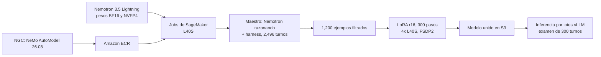

# NVIDIA

[English](../en/nvidia.md) · [Volver al README](../../README.es.md)

SuperLeads solicitó entrar a **NVIDIA Inception** el 1-oct-2026 y fue aceptada el 8-oct-2026. La meta es poder decir,
con verdad, «entrenamos nuestra propia IA de admisiones sobre NVIDIA», y servirla en AWS.

## Lo que usamos hoy de NVIDIA

| Tecnología de NVIDIA | Cómo la usamos |
|---|---|
| **Nemotron 3.5 Lightning 30B-A3B** (BF16) | Modelo base de todos los entrenamientos (LoRA v3, v4, v5). Mezcla de expertos híbrida con ~3B parámetros activos por token: calidad de modelo grande con costo de modelo chico |
| **Nemotron 3.5 Lightning 30B-A3B NVFP4** | Checkpoint cuantizado para inferencia por lotes del modelo sin entrenar en una sola L40S (ml.g6e.2xlarge, ~$2.80 USD/h de lista) |
| **NeMo AutoModel 26.08** (contenedor NGC) | Framework del LoRA: FSDP2, activation checkpointing, atención con Transformer Engine, cargador de chats de agente con manejo del razonamiento. Copiado de NGC a Amazon ECR para SageMaker |
| **Transformer Engine, kernels de Mamba** | Verificados dentro del contenedor antes del primer job pagado |
| **NVIDIA L40S** (ml.g6e.2xlarge / 12xlarge) | Todo el entrenamiento e inferencia facturados: 24.1 horas de instancia con GPU |
| **NVIDIA H100** (ml.p5.4xlarge) | Pedida como segundo carril en cada carrera por capacidad; nunca hubo capacidad en 4 intentos |
| **Modo de razonamiento de Nemotron** | Maestro en la destilación v5: razonar bajó los datos inventados de ~20% a ~7% |

## Cadena de entrenamiento solo NVIDIA

Maestro, alumno y las fichas que se usan como contexto de entrenamiento son **todos Nemotron**. Así los pesos
entrenados no llevan salidas de modelos de terceros (los términos de Anthropic no permiten usar respuestas de Claude o
Fable para entrenar otro modelo sin permiso por escrito), y el resultado es una historia NVIDIA de punta a punta.

## Resultados sobre Nemotron, uno por línea

- Nemotron sin entrenar + nuestro harness ya le gana a la IA de admisiones que usan hoy las escuelas: **5.8–6.5
  contra 4.2–4.8**.
- Razonando: **7.3** (juez 1). Entrenado v5 contestando al instante: **7.2**, con **~1/20 de los tokens**.
- Entrenado v5 razonando: **7.4** (juez 1) / **6.7** (juez 2), **0% de precios**, invita a la visita en 90–92%.
- La distancia con el mejor modelo cerrado (Fable 5.2: 8.2 con el juez 2) es de ~1.5 puntos; las palancas para cerrarla
  son mejores fichas, un maestro más fuerte y un modelo NVIDIA más grande (ver el plan).

## Cómo usamos Inception, y el plan

**Usado hasta hoy:** la membresía y el posicionamiento («entrenado por SuperLeads sobre NVIDIA»); los modelos abiertos
y los contenedores NGC de NVIDIA. **Todavía no usamos** beneficios propios de Inception como créditos de DGX Cloud o
NIM, ni el soporte técnico de NVIDIA. Es cuenta honesta, no queja: primero había que tener resultados.

**Lo que le pediríamos a NVIDIA después:**

1. **Guía técnica** de Nemotron para conversaciones de clientes en español de México: LoRA contra fine-tune completo
   en MoE, control del presupuesto de razonamiento y si servir en NVFP4 un modelo con LoRA unido conserva la calidad.
2. **Acceso a GPU** (DGX Cloud o créditos vía AWS) para: un Nemotron más grande como maestro y alumno, un piloto de 3
   meses con el modelo siempre encendido, y reconocimiento de voz sobre 621 horas de llamadas.
3. **NIM** para servir el modelo entrenado detrás de un endpoint compatible con OpenAI en AWS, en lugar de nuestros jobs
   solo por lotes con vLLM.
4. **Voz**: ASR de NVIDIA (familia Parakeet / Canary) sobre audio telefónico en español y luego un agente de voz que
   agende visitas.
5. **Guardrails**: comparar nuestra guardia en código con NeMo Guardrails para las políticas de precios y becas.
6. **Comarketing**: un caso de estudio de IA educativa en LATAM sobre Nemotron y AWS, cuando el piloto tenga resultados.

El costo de cada experimento está en [Plan y solicitud de créditos](roadmap-and-credits-ask.md).
