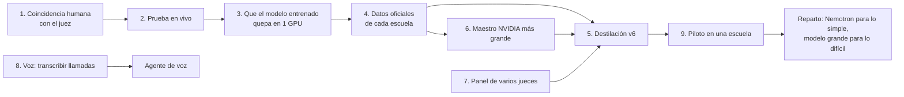

# Plan y solicitud de créditos

[English](../en/roadmap-and-credits-ask.md) · [Volver al README](../../README.es.md)

La primera fase del laboratorio gastó su tope interno de GPU ($299.51 de $300 USD) y dejó un Nemotron entrenado que le
gana, en un examen sin conexión, a la IA de admisiones que usan hoy las escuelas. Falta probarlo con personas y en
producción.

**Todos los costos de abajo son estimaciones** basadas en lo que costaron nuestros jobs y en precios públicos de lista
(ml.g6e.2xlarge ~$2.80 USD/h, ml.g6e.12xlarge ~$13.12 USD/h, ml.p5.4xlarge ~$7.91 USD/h). Spot y créditos cambian el
monto real.

## El plan, en orden

## Experimentos y costo estimado

| # | Experimento | Qué pregunta contesta | Recursos | Costo est. (USD) |
|---|---|---|---|---|
| 1 | Prueba a ciegas con personas: 30 pares, 2 expertos en admisiones | ¿El juez de IA coincide con personas (meta ≥80%)? | Nuestra página | 0 |
| 2 | Prueba en vivo: 10 sesiones de una hora escribiendo como prospecto | ¿Cómo se porta fuera del examen (precios, groserías, preguntas raras)? | g6e.12xlarge, 10 h | ~130 |
| 3 | Cuantizar v5 a NVFP4 y repetir el examen en 1× L40S | ¿El modelo entrenado puede servirse a $2.80/h en lugar de $13.12/h? | g6e.12xlarge 1 h + g6e.2xlarge 1 h + 1 pasada del juez | ~30 |
| 4 | Fichas con datos oficiales; repetir el examen de 3 sistemas | ¿Cuánto del 5–10% que inventa es culpa de la ficha? | Bedrock + 1 examen en GPU | ~60 |
| 5 | Destilación v6: mejores fichas, más espacio para razonar, 3 variantes (rango, vueltas, mezcla de datos) | ¿Qué tan cerca de 8.0 puede llegar Nemotron? | 3 × (maestro + LoRA + unión + examen), v5 costó $70 cada uno | ~250 |
| 6 | Un Nemotron más grande como maestro (y alumno), varias H100 | ¿Un maestro NVIDIA más grande cierra la distancia con los modelos cerrados? | 8× H100 por ~6 h | ~300–600 |
| 7 | Panel de jueces que incluya modelos que no sean de Anthropic | Quitar el sesgo de familia del juez | Bedrock, 3 jueces × 3 sistemas | ~100 |
| 8 | Voz: transcribir 50 llamadas y luego las 621 h | ¿El reconocimiento de voz entiende el español de México por teléfono? | ASR de NVIDIA en L40S (~20 h de GPU) o Amazon Transcribe (~$894 de lista por 621 h) | ~60 (GPU) a ~900 |
| 9 | Piloto en una escuela, 3 meses, prospectos reales | **¿Agenda más visitas que hoy?** | Endpoint siempre encendido en 1× L40S (2,190 h) + Bedrock para lo difícil | ~7,000 |
| 10 | Mantener el agente de operaciones 6 meses | Contenido, SEO, señales comerciales, supervisión | Bedrock Opus (ritmo de nov ~$1,250/mes de lista) + EC2 (~$300/mes) | ~9,300 |

**Laboratorio (1–8): ~$0.9k–2.1k USD. Piloto (9): ~$7k USD. Operación (10): ~$9.3k USD por 6 meses.**

Los créditos de AWS que tenemos hoy (cerca de $9k USD de los $10k USD de créditos AWS Activate Portfolio que obtuvimos por NVIDIA Inception en oct 2026; saldo según el equipo, no se pudo verificar desde el
servidor) cubren el agente de operaciones y los primeros experimentos. **El piloto y tener el modelo siempre encendido
es lo que destraban más créditos.**

## Qué permiten más créditos, en concreto

- **AWS (Activate / créditos):** el piloto de 3 meses en SageMaker (endpoint que se apaga fuera de horario), Bedrock
  para los turnos difíciles del reparto y el panel de jueces, Transcribe o ASR en GPU para la voz, y 6 meses más del
  agente de operaciones. Si el piloto funciona, el mismo stack se lleva a más escuelas de México y LATAM.
- **NVIDIA (Inception):** capacidad de H100 o DGX Cloud para el experimento del maestro grande; NIM para servir; guía
  técnica sobre fine-tuning de Nemotron MoE, servir en NVFP4 y ASR en español; un caso de estudio conjunto cuando el
  piloto tenga resultados.

## El siguiente nivel de créditos que pedimos

AWS lista **AWS Credits for AI Startups** (US$200k+, solo por invitación, para startups listas para escalar después de
Activate Portfolio) como el nivel que se gestiona con el Account Manager de AWS de la startup. Esa es la conversación que
este repositorio respalda: el piloto (9) y seis meses de operación (10) son los usos concretos.

## Decisiones y dependencias (que no son dinero)

- Revisión legal para entrenar con conversaciones anonimizadas de clientes; cláusula en los contratos con escuelas.
- Permiso por escrito de Anthropic antes de usar respuestas de Claude o Fable para entrenar (mientras tanto, solo NVIDIA).
- Permisos de escritura en el CRM de la escuela (mandar mensajes, crear citas) para operar en vivo.
- Una escuela piloto que ya registre sus citas en el CRM.

## Criterios de éxito que nos comprometemos a reportar

| Etapa | Métrica | Meta |
|---|---|---|
| Prueba con personas | Coincidencia con el juez de IA | ≥ 80% de los pares |
| Examen | Invita / da precio / preferida frente a la IA de hoy | ≥ 90% / 0% / ≥ 80% |
| Piloto | Parte de los leads que agenda, contra el periodo anterior de la misma escuela y contra la IA de hoy | Reportar la mejora con intervalo de confianza, sea cual sea |
| Costo | Costo de servir por conversación | Reportar lo real |
