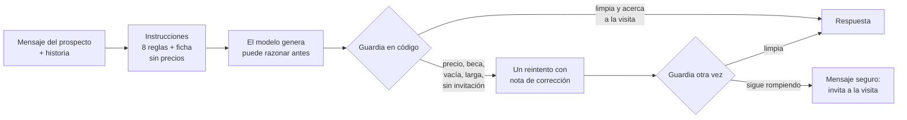
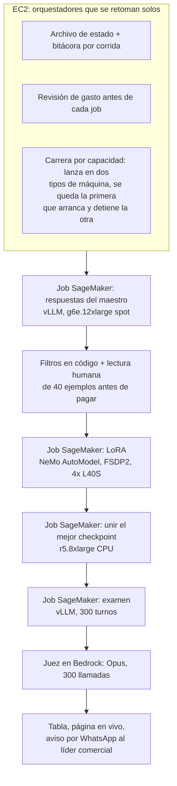

# Entrenamiento y evaluación: una IA de admisiones sobre NVIDIA Nemotron

[English](../en/training-and-evaluation.md) · [Volver al README](../../README.es.md)

**Objetivo.** Una IA que conteste a prospectos y padres de familia de colegios y universidades privadas con un solo
fin: **que agenden su visita al campus**. Nunca da precios ni becas (las escuelas quieren tratarlos en persona), nunca
inventa datos, y suena cálida y breve, en español de México, a cualquier hora.

**Estado (13-nov-2026).** Cinco iteraciones en cinco días. El tercer entrenamiento sirvió. El modelo está guardado, no
encendido; todavía no ha hablado con un prospecto real.

## 1. Datos

| Conjunto | Tamaño | Origen | Uso |
|---|---|---|---|
| Conversaciones cerradas | **1.3M mensajes de chat, 86 mil prospectos, 80 escuelas**, oct-2023 a nov-2026 | CRM de las escuelas, API de solo lectura | Análisis, fichas, turnos de entrenamiento |
| Citas reales | 354,602 leads, 101 escuelas, 12 meses | Calendarios del CRM (solo campos con seudónimo) | La métrica: qué parte de los leads agenda |
| Llamadas (solo metadatos) | 208,751 llamadas; 621 horas de las que duran más de 30 s | CRM | Sin transcribir (la voz está en el plan) |
| Examen | **300 turnos reales, 50 por escuela, 6 escuelas apartadas** | Conversaciones donde contestó la IA actual | Examen a ciegas de todos los sistemas |
| Banco del maestro (v5) | 2,496 turnos, uno por oportunidad, 28 escuelas | Solo escuelas de entrenamiento | Destilación |

**Anonimizado (antes de salir del Worker de extracción):** nombres conocidos de contactos, asesores y empresas;
patrones (correo, teléfono, liga, CURP, RFC, código postal, dirección, números de 6 dígitos o más); contexto («me
llamo», «mi hijo…», títulos); un diccionario de 38 mil nombres y apellidos mexicanos; cualquier palabra con mayúscula
fuera de un vocabulario de 50 mil palabras. Todos los IDs se vuelven seudónimos HMAC-SHA256 con sal. Una segunda
revisión en el servidor manda a cuarentena lo que tenga restos. Se descartan adjuntos y grabaciones.

**Fichas.** Para cada escuela, un modelo lee lo que la propia institución envió (sin duplicados, ordenado por
frecuencia y fecha) y escribe una ficha de ~5 mil caracteres: oferta, horarios, requisitos, pasos de admisión,
ubicación, preguntas frecuentes y lo que *no* ofrece. Antes de llegar a la IA, el código quita las secciones de costos,
becas y formas de pago y cualquier línea con un monto. Las fichas de entrenamiento las escribe el propio Nemotron en
nuestra GPU, para que ninguna salida de Anthropic entre a los datos de entrenamiento, ni siquiera como contexto. Las
conversaciones del examen no se usan para armar fichas.

## 2. El harness

Reglas: acercar a la visita en cada respuesta; nunca precios; nunca becas ni descuentos; solo datos de la ficha; no
inventar horarios; cálida, 1 a 3 frases, máximo 350 caracteres; decir que es IA solo si preguntan; parar cuando el
prospecto no tiene interés. La guardia es código, no un modelo, y se validó contra datos ya calificados antes de usarla
(su detector de «sin invitación» acierta 96% de las veces que marca).

## 3. El examen

- **300 turnos reales** de 6 escuelas que nunca entran al entrenamiento. Todos los sistemas reciben el mismo mensaje y
  la misma historia.
- **Juez a ciegas por pares**: Claude Opus 4.7 (juez 1) y Claude Opus 5.5 (juez 2) en Bedrock ven la ficha completa,
  la conversación y dos respuestas en orden al azar (candidato contra la IA actual). Por respuesta: invita a la visita,
  da precio, habla de becas, inventa, avance hacia la visita, tono, nota global (tope de 4 si rompe una regla) y cuál
  mandaría.
- Las intervenciones de la guardia se reportan junto a las notas.
- Mismo orden A/B para los dos jueces; las fugas de razonamiento y las respuestas vacías se cuentan antes de calificar.

## 4. El pipeline en AWS

Los *training jobs* de SageMaker se usan para entrenar y también para inferencia por lotes: cobran por segundo, se
apagan solos y le quedan mejor a un proyecto con tope de gasto que un endpoint siempre encendido.

## 5. Cinco intentos

| # | Qué | Datos | Configuración | Resultado |
|---|---|---|---|---|
| v3 | Entrenar con conversaciones completas de asesores | 5,422 tramos de conversación | LoRA r16/α32, seq 4096, LR 1e-4, todos los turnos | **Peor que sin entrenar** (4.3 contra 4.9, examen anterior). $116 de GPU |
| Harness v0 | Reglas + ficha + guardia en código, sin entrenar | — | Nemotron base | 6.5 contra 4.8 de la IA actual (juez 1). $0.41 de GPU |
| v4 | Entrenar con respuestas humanas que acercaban la visita | ~850 ejemplos, 41 escuelas, filtrados de 96,895 respuestas | LoRA, GBS 8, 3 vueltas, 263 pasos | **Peor que sin entrenar** (6.2 contra 6.5). La pérdida de validación bajó de 1.94 a 1.53 de todos modos. $42 de GPU |
| Harness v1 | Razonar antes y un reintento si la guardia marca | — | Nemotron base, razonando | **7.3** (juez 1). Razonar bajó lo inventado de 20% a 7%. $2.30 de GPU |
| **v5** | **Destilación: el alumno aprende las respuestas del maestro** | **1,200 ejemplos del maestro**, 28 escuelas | LoRA r16/α32, seq 4096, LR 1e-4, GBS 8, 2 vueltas, 300 pasos, solo último turno | **7.2 contestando al instante** (contra 6.5 sin entrenar), 7.4 razonando. Pérdida de validación 0.88 → 0.69. **$70.33 de GPU de punta a punta, ~6.5 h** |

Maestro v5 = Nemotron sin entrenar razonando dentro del harness v1; alumno = Nemotron contestando sin razonar. Los dos
son NVIDIA. El alumno casi iguala al maestro (7.2 contra 7.3) con **15.9 mil contra 333 mil tokens generados para 300
respuestas (~1/20)**, y eso es lo que hace costeable contestar en tiempo real.

## 6. Resultados

**Juez 1 (Claude Opus 4.7), 300 turnos**

| Sistema | Global | Invita | Precio | Becas | Inventa | Preferida frente a la IA actual |
|---|---|---|---|---|---|---|
| IA actual (integrada al CRM, GPT-4.1, prompt de cada escuela) | 4.8 | 29% | 7% | 8% | 30% | — |
| Nemotron base + harness v0 | 6.5 | 69% | 0% | 0% | 20% | 73% |
| Nemotron v4 (respuestas humanas) + harness | 6.2 | 66% | 0% | 1% | 15% | 66% |
| Nemotron base + harness v1, razonando | 7.3 | 85% | 0% | 0% | 7% | 83% |
| **Nemotron v5 (destilado) + harness v1, al instante** | **7.2** | **89%** | **0%** | **0%** | **10%** | **80%** |
| **Nemotron v5 + harness v1, razonando** | **7.4** | **90%** | **0%** | **0%** | **7%** | **81%** |
| Claude Sonnet 5.5 + harness | 8.0 | 92% | 0% | 0% | 5% | 92% |

**Juez 2 (Claude Opus 5.5, más estricto), mismos 300 turnos, más Fable 5.2**

| Sistema | Global | Invita | Precio | Inventa | Preferida frente a la IA actual |
|---|---|---|---|---|---|
| IA actual (GPT-4.1) | 4.2 | 32% | 8% | 34% | — |
| Nemotron base + harness v0 | 5.8 | 70% | 0% | 22% | 69% |
| Nemotron v4 + harness | 5.4 | 68% | 0% | 17% | 60% |
| Nemotron base + harness v1, razonando | 6.5 | 86% | 0% | 10% | 78% |
| Nemotron v5 + harness v1, al instante | 6.6 | 90% | 0% | 8% | 79% |
| **Nemotron v5 + harness v1, razonando** | **6.7** | **92%** | **0%** | **5%** | **77%** |
| Claude Sonnet 5.5 + harness | 7.8 | 94% | 0% | 2% | 93% |
| **Claude Fable 5.2 + ficha + ejemplos de estilo + harness** | **8.2** | 94% | 0% | 2% | **96%** |

Se calificaron trece sistemas candidatos contra la IA actual; las tablas completas viven en el repositorio privado.
Los dos jueces ordenan los sistemas casi igual.

**Advertencias que van con cualquier número**

- Los dos jueces son de Anthropic y pueden favorecer a Claude y a Fable.
- El examen mide *nuestras* reglas; la IA actual nunca las recibió.
- «Inventa» se juzga contra nuestra ficha, que sale de conversaciones y no de datos oficiales de la escuela.
- Ninguna persona ha calificado todavía; nada se ha probado con prospectos reales.
- 23 respuestas de dos variantes que razonan fueron bloqueadas por el filtro de contenido de Bedrock con el juez 2 y se
  reportan aparte.

## 7. Lecciones

1. **Que baje la pérdida no dice nada de la tarea.** En v4 bajó 21% y el modelo empeoró. Siempre se corre el examen.
2. **Las respuestas humanas nunca se escribieron con las reglas que se califican.** Un modelo que las copia no le gana a
   uno con instrucciones. Hay que entrenar con un maestro que sí sigue las reglas, con cada conducta (invitar,
   confirmar, despedirse, dejar para la visita lo que no se sabe) en su proporción natural, no 100% «invitar».
3. **Lo que ayuda es razonar, no el reintento.** El segundo intento arregló solo 12 de 48 respuestas marcadas.
4. **La destilación vuelve rápido lo que era lento**, con ~1/20 de los tokens y casi sin perder calidad.
5. **Leer ejemplos antes de pagar GPU.** Dos veces un set se veía bien por conteo y estaba mal por contenido.
6. **Revisar fugas en cada modo de generación.** Con razonamiento, el pensamiento sin terminar salió como respuesta en
   38 de 300 casos hasta que una regla en código lo atrapó.
7. **El harness vale lo que vale su ficha.** Los datos oficiales de cada escuela son la siguiente palanca.
8. **Planear la capacidad de GPU.** La L40S bajo demanda esperó más de 30 minutos y la H100 (p5) nunca arrancó en 4
   intentos; lanzar en dos tipos de máquina y quedarse con la primera evitó pagar doble.
9. **Las reglas de la guardia van en código.** Cero precios y cero becas en todas las versiones, sin importar el modelo.

## 8. Costo de todo el laboratorio

| Concepto | Monto | Fuente |
|---|---|---|
| Jobs de SageMaker (GPU y CPU) | 29 jobs, 24.8 h facturables, **$299.51 USD** | Segundos facturables × precio de lista, por job |
| de eso, entrenamiento LoRA | $259.17 (19.8 h), incluye $116 del enfoque v3 que no sirvió | igual |
| de eso, inferencia por lotes (exámenes, maestro, fichas) | $38.71 | igual |
| de eso, uniones (CPU) | $1.64 | igual |
| Bedrock (jueces y modelos de referencia) | 11,957 llamadas; 53.1M tokens de entrada, 3.9M de salida | Registro de tokens por llamada |
| Bedrock, pasada del juez 2 (13 sistemas × 300) | ~$100 USD (estimado a precio de lista) | Registro × precio de lista |

El tope interno de GPU de esta fase ($300) está agotado; los 29 jobs están en estado final (terminado, detenido o
fallido).
